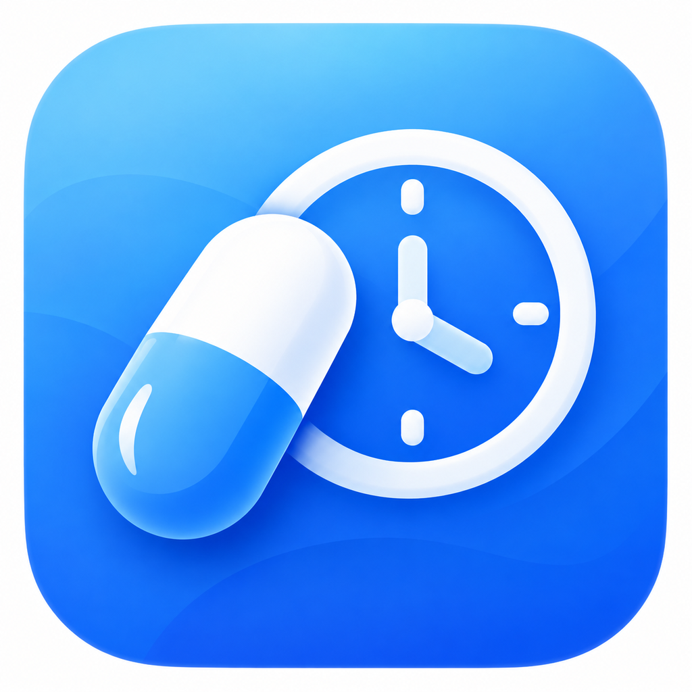

# 药时记 YaoShiJi

**Android 本地用药计划、服药打卡与提醒工具**  
当前版本：**v1.3.4-beta（内部迭代 V15，versionCode 135）**



> [!IMPORTANT]
> 本项目目前为 Beta 测试版。提醒功能受 Android 系统、权限及后台环境影响，不能作为唯一的服药保障。用药方案应遵从医嘱。

## 主要功能

- **用药计划**：添加、编辑药物、剂量、餐前/餐后说明和每日提醒时间。
- **服药打卡**：当天提前/延后打卡，超出计划时间 ±60 分钟时二次确认；支持补签、撤销与备注。
- **智能提醒**：完成某日某次任务后取消该次待触发提醒；其他任务和次日计划照常保留。
- **连续服药统计**：统计连续打卡天数；调整同一药物的方案后，仍可追溯旧方案的历史打卡。
- **可视化记录**：月历完成状态、用药记录和中断信息。
- **库存管理**：库存数量、扣减流水、补充库存与预计可用日期。
- **备份恢复**：本地 ZIP 导出/导入、手动或定期 WebDAV 备份；自动备份采用 7-4-12 保留策略。

## V15 版本变更

**v1.3.4-beta / V15**：修复「修改用药方案后日历勾号还在，但首页连续服药天数归零」的问题。统计以同一药品的历史方案为范围跨版本计算，不删除既有记录。

同时保留 **v1.3.3-beta / V14** 的功能：当天某次任务已成功打卡，则不再为该任务推送计划时间提醒；在到点前撤销打卡，可重新安排提醒。

详见 [更新日志](CHANGELOG.md) 和 [V15 发布说明](RELEASE_NOTES_v1.3.4-beta.md)。

## 运行环境

| 条目 | 配置 |
| --- | --- |
| Android 最低版本 | Android 8.0 / API 26 |
| 目标版本 | Android API 35 |
| 开发语言 | Java 17 |
| 构建 | Android Gradle Plugin 8.7.3 / Gradle 8.9 |
| 应用包名 | `com.yaoshiji.app` |
| 数据存储 | SQLite（Schema 3） |
| 备份包格式 | ZIP / formatVersion 2 |
| 已知适配场景 | 华为 Mate 60 Pro+、HarmonyOS 7、卓易通（需实机验证） |

## 获取与安装

在仓库的 **Releases** 页面下载由项目维护者提供的、签名已核验的 APK（**本源码包不包含预编译 APK**）。第三方重新打包或 CI 临时签名的调试 APK 不应被视为官方升级包。

**升级已有安装时，请勿先卸载旧版。** 为了保留本机数据，新的 APK 必须使用与当前已安装版本一致的签名证书，且 `versionCode` 不低于已安装版本。升级前先在应用内导出本地备份。

## 开发与编译

推荐 Windows + JDK 17 + Android SDK Platform 35 + Build Tools 35.0.0。

```powershell
# 进入本项目根目录后，使用本地 Android SDK 的离线构建脚本
.\build-apk-offline.ps1
```

也可使用 `build-apk.ps1`（使用 Gradle，首次构建可能需要联网下载组件）。对应的 Windows 批处理入口为 `一键编译APK.bat`、`build-apk.cmd` 和 `build-apk-offline.cmd`。

构建脚本从 `app/build.gradle` 读取当前版本标识，离线构建预期输出：

```text
YaoShiJi-v1.3.4-beta-debug.apk
```

**签名注意：** 离线脚本读取项目根目录的本地 `debug.keystore`，如不存在会生成一套新的调试密钥。新密钥与已安装 APK 的签名不一致时**不能覆盖升级**。密钥只在个人电脑安全存储，绝不可提交至 GitHub。GitHub Actions 仅构建 CI 调试工件，不能替代现有设备所需的原签名。

详细要求见 [构建说明](docs/BUILDING.md) 和 [GitHub 发布操作](docs/GITHUB_PUBLISHING.md)。

## 隐私和数据安全

- 服药记录和库存数据存放在本机应用私有数据库中。
- WebDAV 仅在用户配置后进行连接/备份；WebDAV 密码采用 Android Keystore 保护，不会写入导出备份。
- **备份 ZIP 本身不加密**，可能包含药品名称、剂量和打卡日期；请谨慎共享或上传。
- WebDAV 代码同时支持 `http://` 与 `https://`，强烈建议只连接可信 HTTPS 服务；HTTP Basic 认证在 HTTP 下不安全。

请阅读 [隐私说明](PRIVACY.md) 与 [安全政策](SECURITY.md)。

## 已知限制与测试状态

- 在部分卓易通运行环境中，将兼容实例从最近任务中清除可能使提醒停止；设备重启后建议至少主动打开一次应用。
- V14「提前完成后取消提醒」已收到使用者实测通过反馈。
- V15「跨方案连续天数」已作源码修复，**尚待真机回归验证**；当前准备包未在此环境完成 Android APK 编译。
- GitHub Actions 构建任务已配置，但需上传仓库后由 Actions 实际执行，**不能预先视为已通过**。

详见 [构建/验收状态](BUILD_STATUS.json) 及 [回归测试表](docs/TESTING.md)。

## 参与和反馈

欢迎通过 Issues 提交功能建议或错误报告；提交前请删除截图中的药品名称、个人信息、服务器地址和其他敏感信息。参见 [贡献指南](CONTRIBUTING.md)。安全漏洞请按 [安全政策](SECURITY.md) 私下报告。
